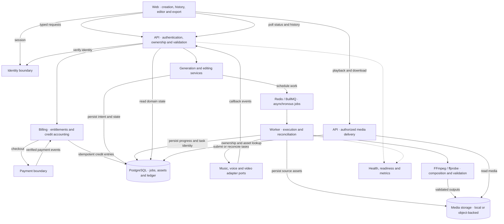
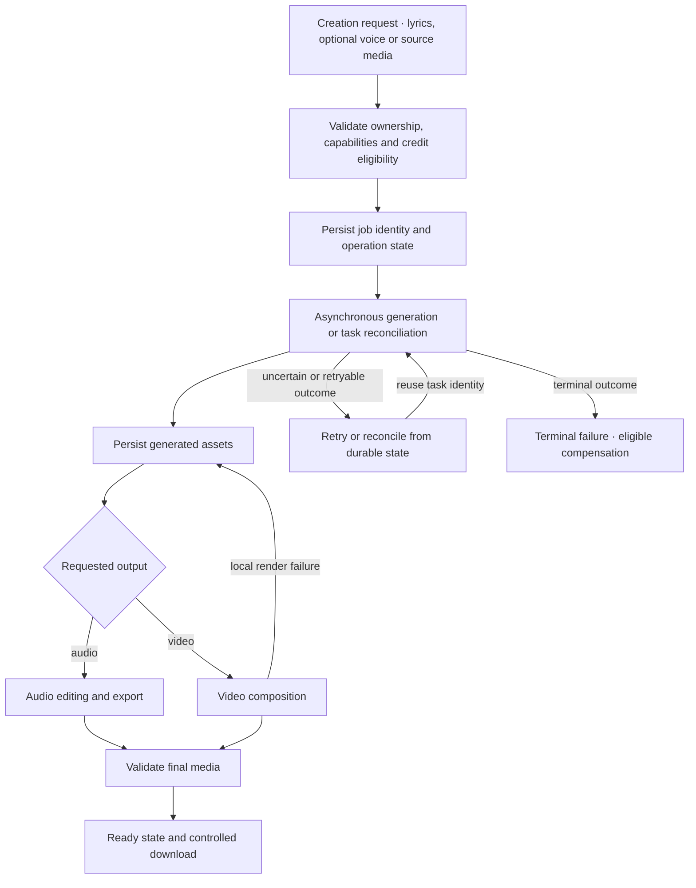
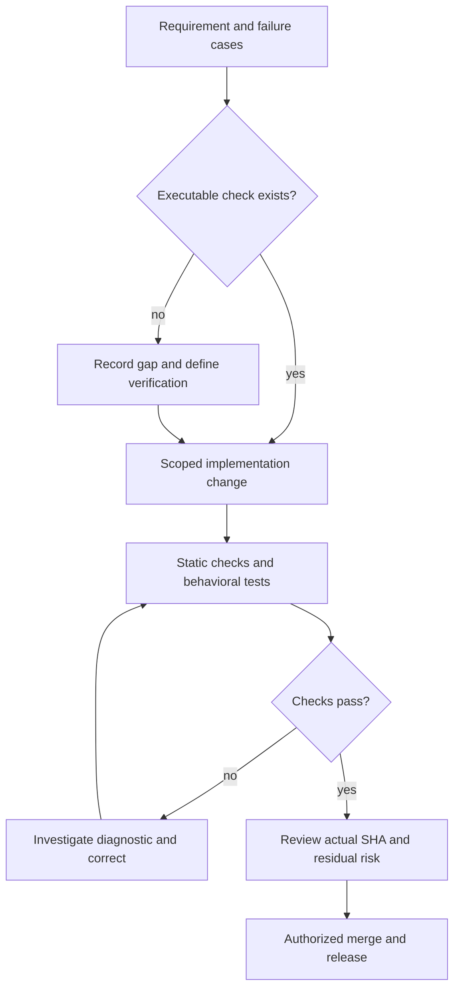

# AI Music — Technical Showcase

TypeScript monorepo for asynchronous music generation, personal-voice workflows, browser-based audio editing, and short-form video composition.

The application separates the web client, HTTP API, and background workers. PostgreSQL stores domain state and credit transactions; Redis/BullMQ schedules asynchronous work; FFmpeg handles media composition and validation.

This public snapshot uses demo adapters and illustrative configuration. Production credentials, commercial integration identities, proprietary prompts, routing policies, negotiated pricing, and infrastructure identifiers are excluded.

## Responsibilities and failure handling

| Concern | Implementation approach | Intended property |
| --- | --- | --- |
| Authorization | API-side identity and resource ownership checks | Client input cannot establish ownership |
| Long-running operations | Queue-backed background workers | Processing is independent of the HTTP request lifecycle |
| External task recovery | Persisted task identity and reconciliation | Known work can be recovered before resubmission |
| Composition retries | Separate source assets and render state | Local retries can reuse persisted assets |
| Credit accounting | Append-only ledger and idempotent transitions | Repeated event delivery does not duplicate eligible mutations |
| Media readiness | Output validation before publication | Readiness depends on a validated artifact |

## System design

Logical product architecture. External services are represented by neutral ports; the public snapshot supplies demo implementations where available.



| Boundary | Responsibility |
| --- | --- |
| Web | Creation forms, optional voice onboarding, progress, history, timeline editing and downloads |
| API | Identity verification, ownership, validation, entitlements, job submission and media access |
| Worker | External task execution, reconciliation, asset persistence and media processing |
| Database | Durable domain state, task references, asset metadata and credit transactions |
| Queue | Delivery and retry scheduling; domain completion is recorded in the database |
| Storage | Voice references, generated audio, intermediate assets and validated exports |
| External ports | Generation, identity and payment integrations behind application-facing contracts |

Payment events are verified server-side before accounting changes. Provider callbacks enter the API boundary and require validation; external success alone does not make an export ready. Database writes, queue delivery and external submissions are separate operations.

### Generation, editing and recovery

Conceptual lifecycle; individual entities use their own state models.



Persisted assets separate external generation from local composition. Composition retries can reuse existing inputs. Recovery reconciles known external work before a replacement submission; delivery is not assumed to be globally exactly-once.

## Architectural patterns

- **Ports and adapters:** domain-facing contracts separate product policy from integration mechanics.
- **Durable workflow state:** retries resume from recorded progress instead of process memory.
- **Idempotency and compensation:** ledger identities and recovery paths address repeated delivery and partial failure. No claim of global exactly-once execution.
- **Feature-oriented frontend:** UI features use a typed API boundary rather than importing persistence or worker internals.
- **Application-owned media:** generated assets become durable inputs to composition instead of relying on expiring external links.
- **Defense in depth:** ownership checks, server-side entitlements, local demo defaults and public-content checks address different trust boundaries.

Read the [architecture](docs/architecture.md), [engineering decisions](docs/engineering-highlights.md), [functional scope](docs/product-overview.md), and [security design](docs/security-design.md).

## AI-assisted engineering controls

### Audit scope and branch distinction

Source-configuration audit dated **2026-11-15**. The private project's `main` branch was inspected at `72083b1a`; `staging` was inspected at `c1d01d01`. These are branch states, not independently verified deployment identities.

The security and architecture follow-ups were merged into **staging**, which was 14 commits ahead of main at this audit. Their presence in staging must not be described as enforcement in the production branch.

### Verified controls in the main branch

| Area | Repository evidence | Actual scope |
| --- | --- | --- |
| Agent context | Root `AGENTS.md`, domain rules and skills under `.cursor/` | Written instructions for agents; not proof of compliance or automatic loading by every agent |
| Engineering constraints | Rules for scope, dependencies, storage, accounting and review | Most architectural constraints are expressed in prose |
| ESLint | Shared recommended JS/TS configs; Next.js configs | Web explicitly forbids the top-level integration-adapter import; full service/feature boundary enforcement is not present |
| TypeScript | Workspace typecheck command in CI | Type and contract checking; not architectural or business-logic verification |
| Regression contracts | Test scripts and authorization/accounting/recovery test files | Tests are invoked in CI; file presence alone does not establish complete coverage |
| Code review | Local QUICK/STANDARD/DEEP review policy and skill | Agent-assisted review workflow; no demonstrated automated review gate |
| Feature branches and PRs | Separate implementation branches and reviewed staging PRs | Branch workflow exists; mandatory branch protection could not be verified |
| NFRs | Production-readiness rules, release checklist, recovery/security invariants | Requirements are documented in several places; no complete measured NFR/SLO compliance matrix was established |
| Load testing | Manually triggered fake-service load workflow | Test configuration exists; current performance results and production capacity were not validated |
| Infrastructure | Local Compose configuration, a test-service Dockerfile and CI workflows | Partial environment automation; not a complete production IaC or drift-validation system |

The main-branch CI runs dependency installation, database client generation, typecheck, lint, unit/contract tests, build-environment validation and build. Additional workflows cover selected media/database release checks and manually triggered fake-service load tests. A successful CI run was observed for the audited main SHA; no local test suite was rerun during this source audit.

### Controls implemented in staging, not yet in audited main

| Control | Staging evidence | Audited main |
| --- | --- | --- |
| Gitleaks | Configuration and commit-range/manual-history workflows | Configuration and scanning workflow absent |
| Dependabot | Workspace and Actions update configuration | Configuration absent; account-level alerts remain unverified |
| ESLint boundaries | Expanded web/server/package restrictions and a documented legacy exception | Expanded rules absent |
| dependency-cruiser | Cycle configuration and known-violation baseline | Dependency, configuration and cycle command absent |
| Semgrep | Structural security rules, negative/positive fixtures and CI invocation | Rules, fixture runner and CI invocation absent |
| Download/credential regressions | Additional unit, HTTP integration and Chromium checks | Follow-up implementations/tests not promoted |

These describe completed staging changes, not planned capabilities and not controls installed in this showcase. The public snapshot's CI independently runs its own publication check, typecheck, lint, tests and build.

### Requested tools and methods not established in audited main

| Area | Audit result |
| --- | --- |
| eslint-plugin-boundaries / Madge | No direct dependency, dedicated configuration or CI invocation found |
| SonarQube / SonarCloud / CodeRabbit | No repository-based quality/review integration established; externally installed services were not independently verified |
| CodeQL / ast-grep / Tree-sitter rule sets | No configured analysis pipeline found |
| Knip / ts-prune / jscpd | No configured unused-code or duplication gate found |
| Cyclomatic / cognitive / Halstead metrics | No measurement report or enforced threshold found |
| Coupling/cohesion metrics | No quantified maintainability gate established |
| Trivy / OWASP ZAP | No configured container or running-application scan gate found |
| Formal verification | No CFG/SSA/SMT proof pipeline or formal business-invariant verification found |
| BMAD / SDD tooling | No installed framework configuration or traceable generated workflow established |
| Full production IaC | No Terraform/Pulumi/CDK deployment or policy/drift-validation pipeline found in the inspected tree |

Task plans and contract-first testing rules provide elements of specification-oriented work. They do not establish adoption of BMAD or a formal Spec-Driven Development framework.

### Enforcement gaps and correction workflow

The agent rules prescribe file/function size limits, but no corresponding executable gate was found. Large modules remain in main. Documentation of a constraint must therefore be separated from demonstrated enforcement.

A diagnostic-driven workflow should connect a requirement to an executable rule or behavioral test, apply a scoped correction, and verify the reviewed commit before release. This is the required operating model; the audit does not establish that every change already follows it.



CI success does not prove absence of vulnerabilities. Static rules do not prove business correctness. A lower complexity score does not alone justify refactoring. Branch protection, deployment identity and externally configured scanning remain separate verification tasks.

## Local setup

The source uses Next.js / React / TypeScript, Fastify, PostgreSQL / Prisma, Redis / BullMQ and FFmpeg. These are implementation technologies; commercial AI and payment integrations are represented by neutral demo boundaries.

```bash
corepack enable
pnpm install --frozen-lockfile
cp .env.example .env
pnpm db:generate
```

For local runtime exploration, provide local PostgreSQL and Redis, then run `pnpm db:push` and `pnpm dev`. Inspect `.env.example` for local ports. No paid account is required for the intended mock flows. Complete end-to-end runtime availability depends on the local database, queue and media tooling; this is not a production deployment distribution.

```bash
pnpm public:check
pnpm typecheck
pnpm lint
pnpm test
pnpm build
```

## Scope and limitations

This repository demonstrates application architecture, not a foundation model. The private product and this snapshot evolve separately. Security patterns described for the private system are not automatically guarantees of this demo: see the [implementation status](docs/security-design.md).

Commercial-looking fixture values are illustrative demo data. They do not disclose production prices, wholesale costs, margins or capacity. No customer counts, conversion rates, uptime figures or savings percentages are claimed here.

## Authorship

**Dmitriy Sedov** — application design and implementation across frontend, API, asynchronous processing, and media pipelines.

Copyright © 2026 Dmitriy Sedov. Published for portfolio review and technical evaluation. See [NOTICE](NOTICE) for usage restrictions.
