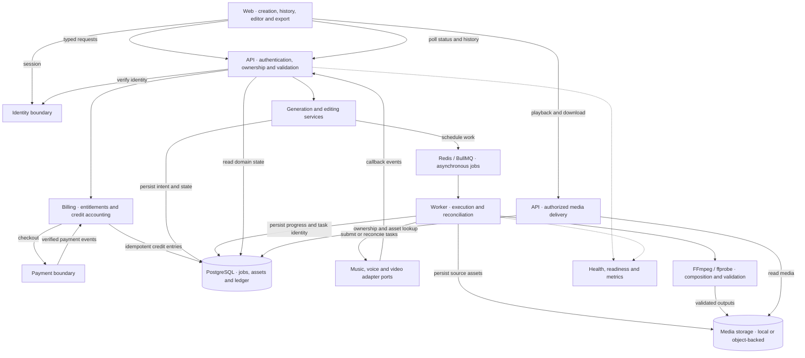
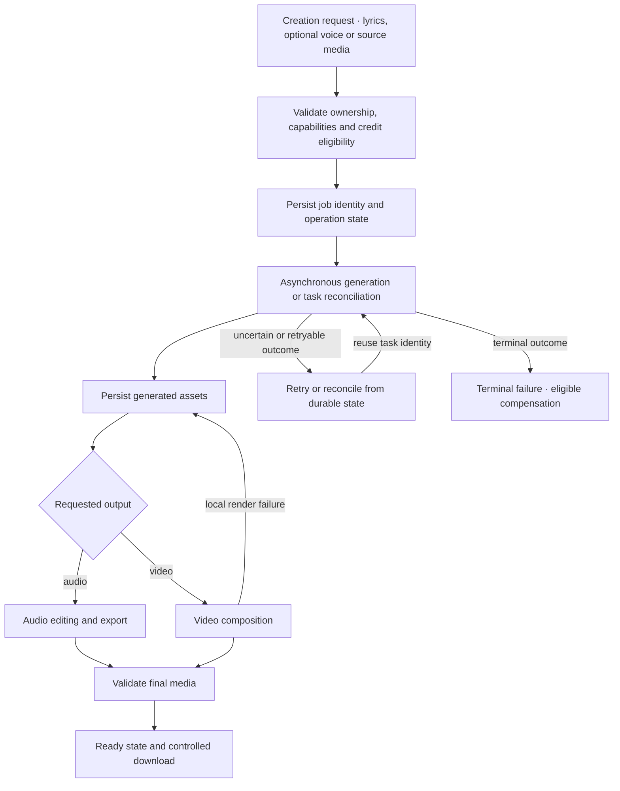
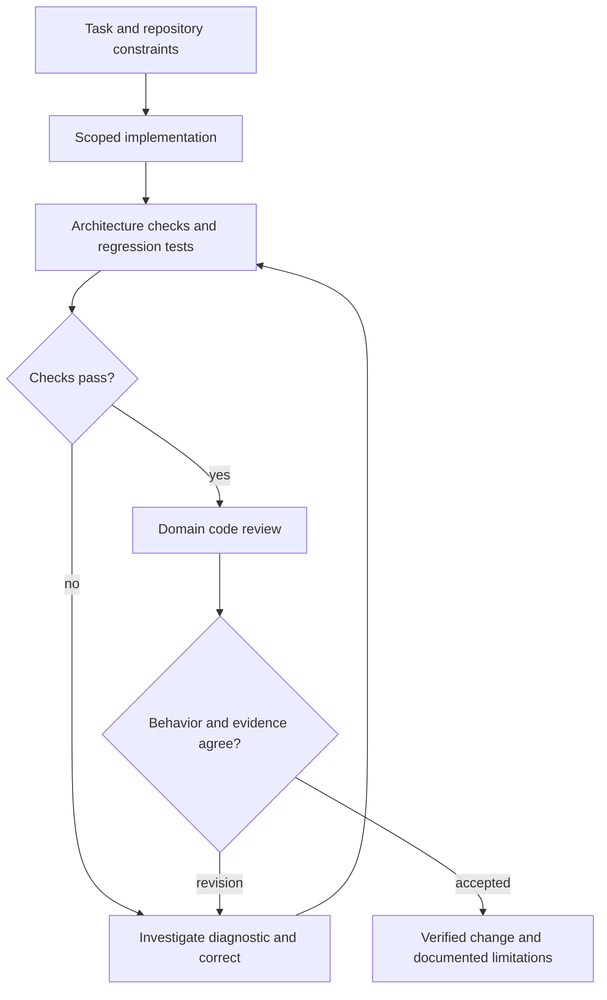

# AI Music — Technical Showcase

TypeScript monorepo for asynchronous music generation, personal-voice workflows, browser-based audio editing, and short-form video composition.

The application separates the web client, HTTP API, and background workers. PostgreSQL stores domain state and credit transactions; Redis/BullMQ schedules asynchronous work; FFmpeg handles media composition and validation.

This public snapshot uses demo adapters and illustrative configuration. Production credentials, commercial integration identities, proprietary prompts, routing policies, negotiated pricing, and infrastructure identifiers are excluded.

## Responsibilities and failure handling

| Concern | Implementation approach | Intended property |
| --- | --- | --- |
| Authorization | API-side identity and resource ownership checks | Client input cannot establish ownership |
| Long-running operations | Queue-backed background workers | Processing is independent of the HTTP request lifecycle |
| External task recovery | Persisted task identity and reconciliation | Known work can be recovered before resubmission |
| Composition retries | Separate source assets and render state | Local retries can reuse persisted assets |
| Credit accounting | Append-only ledger and idempotent transitions | Repeated event delivery does not duplicate eligible mutations |
| Media readiness | Output validation before publication | Readiness depends on a validated artifact |

## System design

Logical product architecture. External services are represented by neutral ports; the public snapshot supplies demo implementations where available.



| Boundary | Responsibility |
| --- | --- |
| Web | Creation forms, optional voice onboarding, progress, history, timeline editing and downloads |
| API | Identity verification, ownership, validation, entitlements, job submission and media access |
| Worker | External task execution, reconciliation, asset persistence and media processing |
| Database | Durable domain state, task references, asset metadata and credit transactions |
| Queue | Delivery and retry scheduling; domain completion is recorded in the database |
| Storage | Voice references, generated audio, intermediate assets and validated exports |
| External ports | Generation, identity and payment integrations behind application-facing contracts |

Payment events are verified server-side before accounting changes. Provider callbacks enter the API boundary and require validation; external success alone does not make an export ready. Database writes, queue delivery and external submissions are separate operations.

### Generation, editing and recovery

Conceptual lifecycle; individual entities use their own state models.



Persisted assets separate external generation from local composition. Composition retries can reuse existing inputs. Recovery reconciles known external work before a replacement submission; delivery is not assumed to be globally exactly-once.

## Architectural patterns

- **Ports and adapters:** domain-facing contracts separate product policy from integration mechanics.
- **Durable workflow state:** retries resume from recorded progress instead of process memory.
- **Idempotency and compensation:** ledger identities and recovery paths address repeated delivery and partial failure. No claim of global exactly-once execution.
- **Feature-oriented frontend:** UI features use a typed API boundary rather than importing persistence or worker internals.
- **Application-owned media:** generated assets become durable inputs to composition instead of relying on expiring external links.
- **Defense in depth:** ownership checks, server-side entitlements, local demo defaults and public-content checks address different trust boundaries.

Read the [architecture](docs/architecture.md), [engineering decisions](docs/engineering-highlights.md), [functional scope](docs/product-overview.md), and [security design](docs/security-design.md).

## AI-assisted engineering controls

### Agent context and implementation workflow

Repository instructions in `AGENTS.md` and domain-specific rules and skills give the agent the module structure, architectural constraints, accounting invariants and verification requirements. Tasks define the affected behavior, acceptance criteria and permitted scope before implementation.

The workflow connects a concrete requirement to a code change, automated diagnostics and behavioral tests. Findings identify the relevant file, rule and execution path; corrections are checked against the original contract.

### Automated architecture and security checks

The following controls are configured in the main application project. This public showcase retains a reduced verification pipeline and sanitized examples.

| Control | How it is organized |
| --- | --- |
| **Gitleaks** | Scans PR commit ranges and repository history. Known false positives use narrow exceptions; scanner output redacts detected values. A separate manual workflow supports full-history checks. |
| **Dependabot** | Weekly update configuration covers workspace dependencies and GitHub Actions. Compatible minor/patch updates are grouped and reviewed with bounded open-update counts. |
| **ESLint boundaries** | Targeted import restrictions keep database, storage and integration implementations out of web code, prevent server packages from depending on web, and restrict cross-feature style imports. Explicit legacy exceptions remain documented. |
| **dependency-cruiser** | Builds the dependency graph with workspace and alias resolution. CI rejects new cycles; existing exceptions are recorded in a specific baseline. |
| **Semgrep** | Structural rules flag unsafe raw SQL APIs, process execution outside designated modules, explicit shell execution and selected storage/server-import violations. Fixtures check aliases, namespace imports, module loading, expected findings and clean examples. |
| **Download and credential regressions** | Unit and HTTP integration tests cover URL validation, DNS pinning, redirects, shared deadlines, response cleanup and address classification. Chromium tests exercise the real authenticated media helper: direct delivery, redirect rejection and refusal to send Bearer credentials to an untrusted origin. |

The selected approach uses explicit import rules for a small layer matrix, graph analysis for cycles, structural rules for unsafe constructs and behavioral tests for runtime contracts. Analyzer fixtures verify that rules detect prohibited examples without flagging permitted ones.

### Code review

A separate agent-assisted review workflow checks the actual diff and affected dependency paths. Review depth increases for changes involving authorization, accounting, external side effects, queues, storage or migrations.

| Review area | What is checked |
| --- | --- |
| Correctness and contracts | Changed behavior, API compatibility, validation, error handling and regression coverage |
| Authentication and ownership | Server-authoritative identity, resource access, admin boundaries and callback verification |
| Payments and credits | Verified payment state, idempotent grants/debits/refunds, original-amount compensation and ambiguous outcomes |
| Asynchronous state | Duplicate delivery, callback/poll races, stale transitions, worker restarts and crash recovery |
| Integrations and media | Persisted task affinity, repeated external submissions, trusted URLs, credential handling and output readiness |
| Data and frontend | Transaction boundaries, migration effects, browser/server separation and unintended side effects on mount |

Each finding must describe what breaks, the execution path, code evidence and severity. A validation pass attempts to disprove the finding before it is accepted. Focused tests and applicable checks validate the correction; formatting preferences are kept separate from defect review.

### Refactoring and verification

Maintainability work is scoped around module responsibilities, coupling and behavioral contracts. Extracting functions solely to lower a metric is not an acceptance criterion. Regression expectations must come from the intended contract rather than being changed to fit the implementation.



## Local setup

The source uses Next.js / React / TypeScript, Fastify, PostgreSQL / Prisma, Redis / BullMQ and FFmpeg. These are implementation technologies; commercial AI and payment integrations are represented by neutral demo boundaries.

```bash
corepack enable
pnpm install --frozen-lockfile
cp .env.example .env
pnpm db:generate
```

For local runtime exploration, provide local PostgreSQL and Redis, then run `pnpm db:push` and `pnpm dev`. Inspect `.env.example` for local ports. No paid account is required for the intended mock flows. Complete end-to-end runtime availability depends on the local database, queue and media tooling; this is not a production deployment distribution.

```bash
pnpm public:check
pnpm typecheck
pnpm lint
pnpm test
pnpm build
```

## Scope and limitations

This repository demonstrates application architecture, not a foundation model. The private product and this snapshot evolve separately. Security patterns described for the private system are not automatically guarantees of this demo: see the [implementation status](docs/security-design.md).

Commercial-looking fixture values are illustrative demo data. They do not disclose production prices, wholesale costs, margins or capacity. No customer counts, conversion rates, uptime figures or savings percentages are claimed here.

## Authorship

**Dmitriy Sedov** — application design and implementation across frontend, API, asynchronous processing, and media pipelines.

Copyright © 2026 Dmitriy Sedov. Published for portfolio review and technical evaluation. See [NOTICE](NOTICE) for usage restrictions.
