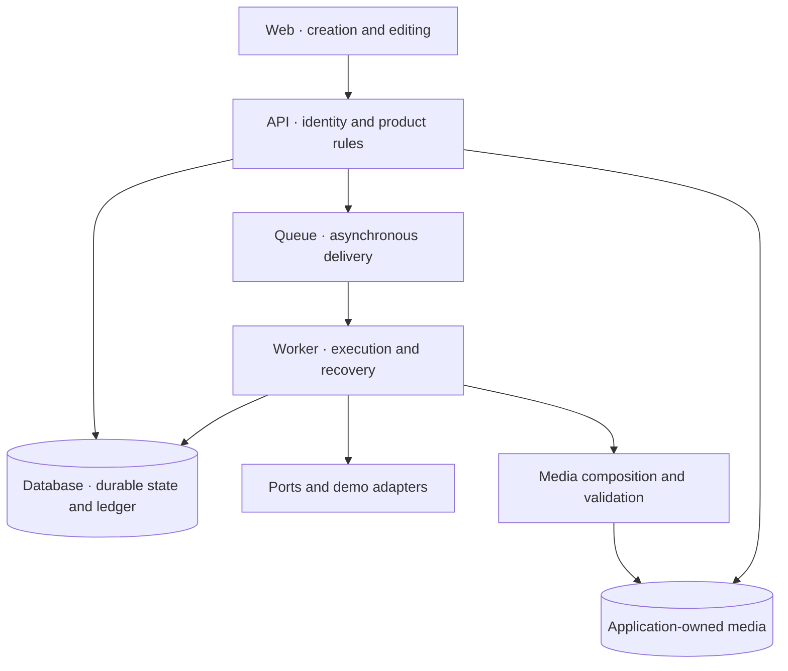

# AI Music · From a fleeting idea to something worth sharing

**A creative product on the surface. A distributed systems problem underneath.**

A line of lyrics. A voice recording. A photo with a story behind it. AI Music brings those fragments into a single creative journey: make a song, shape it in an audio editor, and turn it into a shareable video.

The interesting engineering begins when the user presses **Create**. External work takes time. A callback may arrive twice. A worker can restart after an external operation succeeds. A render can fail after the expensive part is already complete. The product must make all of that feel like one coherent experience.

This public repository is an independently sanitized **architecture showcase** of a privately maintained SaaS. It contains demo adapters and illustrative policies, not production integration recipes. Vendor identities, negotiated terms, production credentials, prompts, operational thresholds and private infrastructure are outside its public contract.

## The story behind the architecture

The first challenge is creative: help someone reach a result without making them understand the machinery. The second is operational: make a slow, failure-prone workflow recoverable. The third is commercial: retries should not silently become repeated spending or duplicate credit deductions.

That led to three process boundaries, durable state, explicit side-effect identities, and adapters that keep external systems replaceable. These are design choices with product consequences—not a list of frameworks.

| Product moment | Engineering decision | Why it matters |
| --- | --- | --- |
| A user starts a creation | API validates ownership and records intent | The browser cannot authorize its own resources |
| The result takes time | Queue-backed worker outside the HTTP lifecycle | Navigation and processing have separate lifetimes |
| A provider response is uncertain | Persist task identity and reconcile before resubmitting | Recovery does not blindly repeat expensive work |
| A render fails | Keep source assets separate from composed output | Retry local composition without recreating assets |
| A payment callback repeats | Verified, idempotent ledger transitions | Repeated delivery must not grant credits twice |
| A video looks finished | Validate media before publishing readiness | “Ready” describes an artifact, not just a successful request |

## System at a glance



**3 process roles. 1 durable source of domain truth. Explicit boundaries around external side effects.** These are architecture facts, not traffic or revenue claims.

## Patterns worth inspecting

- **Ports and adapters:** domain-facing contracts separate product policy from integration mechanics.
- **Durable workflow state:** retries resume from recorded progress instead of process memory.
- **Idempotency and compensation:** ledger identities and recovery paths address repeated delivery and partial failure. No claim of global exactly-once execution.
- **Feature-oriented frontend:** UI features use a typed API boundary rather than importing persistence or worker internals.
- **Application-owned media:** generated assets become durable inputs to composition instead of relying on expiring external links.
- **Defense in depth:** ownership checks, server-side entitlements, local demo defaults and public-content checks address different trust boundaries.

Read the [architecture](docs/architecture.md), [engineering decisions](docs/engineering-highlights.md), [product story](docs/product-overview.md), and [security design](docs/security-design.md).

## Explore the showcase

The source uses Next.js / React / TypeScript, Fastify, PostgreSQL / Prisma, Redis / BullMQ and FFmpeg. These are implementation technologies; commercial AI and payment integrations are represented by neutral demo boundaries.

```bash
corepack enable
pnpm install --frozen-lockfile
cp .env.example .env
pnpm db:generate
```

For local runtime exploration, provide local PostgreSQL and Redis, then run `pnpm db:push` and `pnpm dev`. Inspect `.env.example` for local ports. No paid account is required for the intended mock flows. Complete end-to-end runtime availability depends on the local database, queue and media tooling; this is not a production deployment distribution.

```bash
pnpm public:check
pnpm typecheck
pnpm lint
pnpm test
pnpm build
```

## Scope and honesty

This repository demonstrates application architecture, not a foundation model. The private product and this snapshot evolve separately. Security patterns described for the private system are not automatically guarantees of this demo: see the [implementation status](docs/security-design.md).

Commercial-looking fixture values are illustrative demo data. They do not disclose production prices, wholesale costs, margins or capacity. No customer counts, conversion rates, uptime figures or savings percentages are claimed here.

## Authorship

Designed and developed by **Dmitriy Sedov**, spanning frontend experience, API contracts, asynchronous orchestration, media processing and delivery concerns.

Copyright © 2026 Dmitriy Sedov. Published for portfolio review and technical evaluation. See [NOTICE](NOTICE) for usage restrictions.
