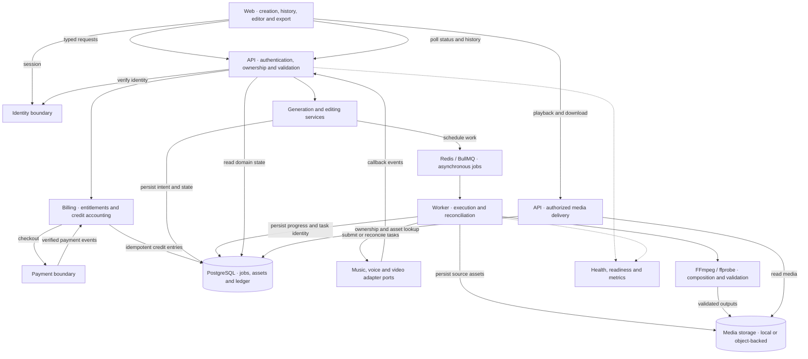
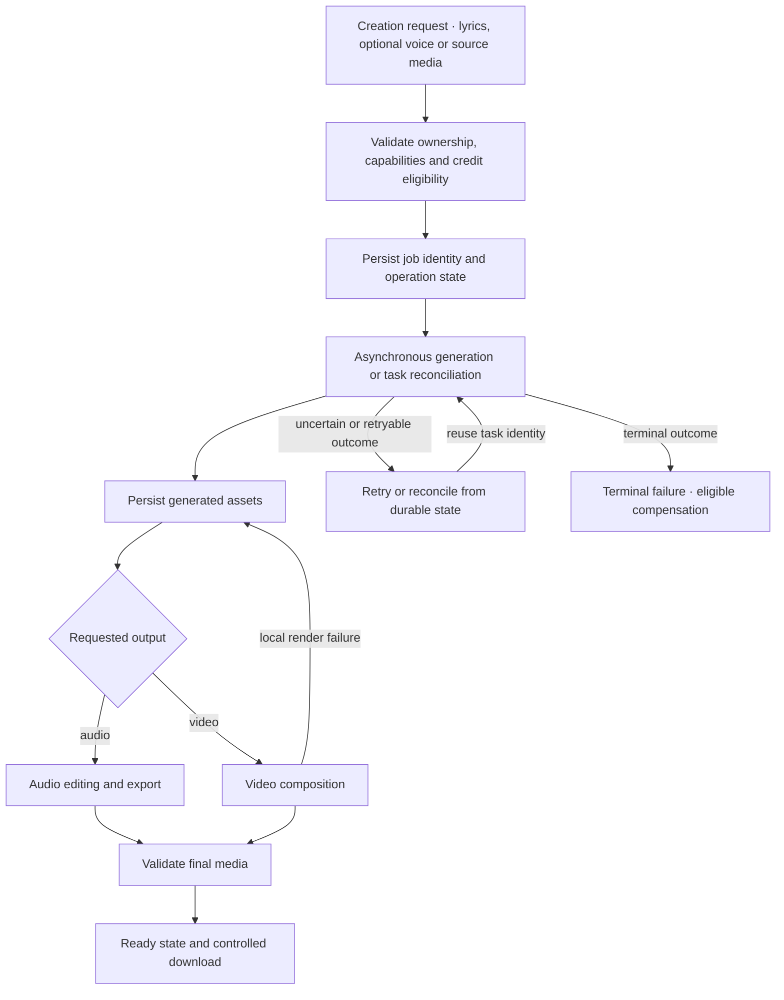
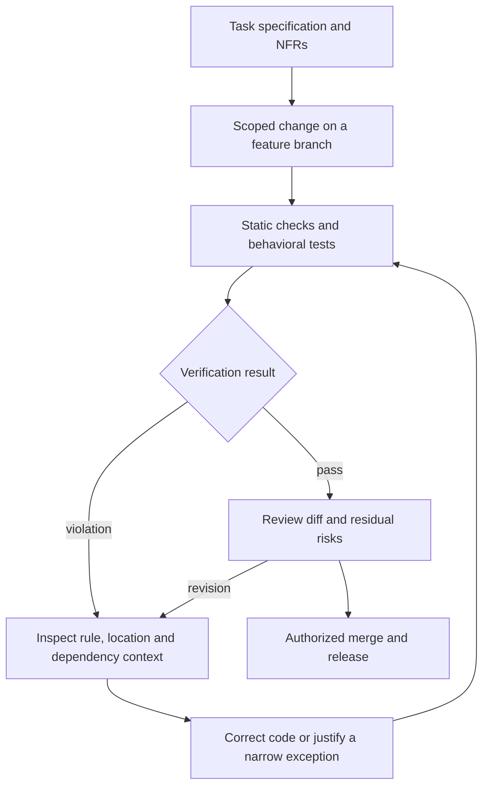

# AI Music — Technical Showcase

TypeScript monorepo for asynchronous music generation, personal-voice workflows, browser-based audio editing, and short-form video composition.

The application separates the web client, HTTP API, and background workers. PostgreSQL stores domain state and credit transactions; Redis/BullMQ schedules asynchronous work; FFmpeg handles media composition and validation.

This public snapshot uses demo adapters and illustrative configuration. Production credentials, commercial integration identities, proprietary prompts, routing policies, negotiated pricing, and infrastructure identifiers are excluded.

## Responsibilities and failure handling

| Concern | Implementation approach | Intended property |
| --- | --- | --- |
| Authorization | API-side identity and resource ownership checks | Client input cannot establish ownership |
| Long-running operations | Queue-backed background workers | Processing is independent of the HTTP request lifecycle |
| External task recovery | Persisted task identity and reconciliation | Known work can be recovered before resubmission |
| Composition retries | Separate source assets and render state | Local retries can reuse persisted assets |
| Credit accounting | Append-only ledger and idempotent transitions | Repeated event delivery does not duplicate eligible mutations |
| Media readiness | Output validation before publication | Readiness depends on a validated artifact |

## System design

Logical product architecture. External services are represented by neutral ports; the public snapshot supplies demo implementations where available.



| Boundary | Responsibility |
| --- | --- |
| Web | Creation forms, optional voice onboarding, progress, history, timeline editing and downloads |
| API | Identity verification, ownership, validation, entitlements, job submission and media access |
| Worker | External task execution, reconciliation, asset persistence and media processing |
| Database | Durable domain state, task references, asset metadata and credit transactions |
| Queue | Delivery and retry scheduling; domain completion is recorded in the database |
| Storage | Voice references, generated audio, intermediate assets and validated exports |
| External ports | Generation, identity and payment integrations behind application-facing contracts |

Payment events are verified server-side before accounting changes. Provider callbacks enter the API boundary and require validation; external success alone does not make an export ready. Database writes, queue delivery and external submissions are separate operations.

### Generation, editing and recovery

Conceptual lifecycle; individual entities use their own state models.



Persisted assets separate external generation from local composition. Composition retries can reuse existing inputs. Recovery reconciles known external work before a replacement submission; delivery is not assumed to be globally exactly-once.

## Architectural patterns

- **Ports and adapters:** domain-facing contracts separate product policy from integration mechanics.
- **Durable workflow state:** retries resume from recorded progress instead of process memory.
- **Idempotency and compensation:** ledger identities and recovery paths address repeated delivery and partial failure. No claim of global exactly-once execution.
- **Feature-oriented frontend:** UI features use a typed API boundary rather than importing persistence or worker internals.
- **Application-owned media:** generated assets become durable inputs to composition instead of relying on expiring external links.
- **Defense in depth:** ownership checks, server-side entitlements, local demo defaults and public-content checks address different trust boundaries.

Read the [architecture](docs/architecture.md), [engineering decisions](docs/engineering-highlights.md), [functional scope](docs/product-overview.md), and [security design](docs/security-design.md).

## AI-assisted engineering controls

AI-assisted changes follow an SDLC with explicit requirements, bounded implementation scope, automated diagnostics, review and controlled release. Agent instructions define repository constraints; executable checks establish whether a change satisfies the rules they cover.

### Specification and agent context

Before implementation, the task specifies the affected workflow, inputs and outputs, acceptance criteria, non-functional requirements, prohibited changes and verification commands. Repository guidance is recorded in [AGENTS.md](AGENTS.md); architecture decisions and existing contracts provide implementation context.

| Specification area | Example constraint | Verification approach |
| --- | --- | --- |
| Authorization | Client-supplied identifiers cannot authorize another user's asset | Ownership and negative-access tests |
| Financial consistency | Repeated delivery cannot duplicate a credit grant or eligible refund | Idempotency and ledger contract tests |
| Recovery | A local render retry reuses persisted generated assets | Lifecycle tests and reconciliation review |
| Resource bounds | External downloads have byte limits and one operation deadline | Oversize, timeout and interrupted-response tests |
| Credential isolation | Application Bearer tokens are sent only to the trusted API origin | URL-policy, HTTP integration and Chromium tests |
| Readiness | Publish the final artifact only after validation | Media probing and state-transition checks |
| Publication safety | Public source must exclude private integration identities and credentials | Tracked-content publication check and review |

These are examples from the engineering workflow. They are not production latency or availability commitments. Numeric SLOs, infrastructure limits and commercial thresholds are not published.

Requirements are reviewed for missing failure cases, contradictory assumptions and boundary conditions before code changes. The specification links each invariant to an appropriate check; not every requirement can be established through static analysis.

### Static analysis and architecture enforcement

The main project and this public snapshot have different verification coverage.

| Control | Application in the main project | Evidence in this public snapshot |
| --- | --- | --- |
| ESLint import restrictions | Enforce selected service/package and feature boundaries | Web/server/shared import restrictions |
| TypeScript | Check types and cross-package contracts | `pnpm typecheck` in CI |
| dependency-cruiser | Reject new dependency cycles against a documented legacy baseline | Not included in the showcase pipeline |
| Semgrep | Structural rules for unsafe raw SQL APIs, process execution, server-only imports and storage boundaries | Not included in the showcase pipeline |
| Semgrep rule fixtures | Expected file/rule findings; clean positive fixtures; scan-error and exit-status checks | Not included in the showcase pipeline |
| Gitleaks | PR commit-range and manually triggered full-history scanning with narrow false-positive exceptions | Showcase publication guard is a separate, narrower check |
| Dependabot | Workspace and Actions update configuration; advisory triage and targeted dependency fixes | No claim that alerts or security updates are enabled here |
| Tests and build | Verify behavior independently of lint findings | `pnpm test` and `pnpm build` in CI |
| Public-content guard | Sanitization before publishing a snapshot | `pnpm public:check` in CI |

AST-based rules match code structure; dependency analysis checks graph relationships. Neither establishes complete business correctness. This project does not claim CFG/SSA-based verification, SMT proofs or formally verified end-to-end execution.

### Diagnostic-driven correction



The agent receives a concrete diagnostic, investigates its execution path, makes a bounded correction, and reruns the relevant checks. A passing metric does not authorize a merge or deployment. CI success is assessed on the actual commit being reviewed.

Verification also covers the analyzers themselves. In the main project, publication-scan exceptions were narrowed after a synthetic credential bypass was reproduced; process-execution rules gained alias, namespace and module-loading fixtures; media-download behavior was checked in a real browser after Node-only tests proved insufficient.

### Complexity and maintainability

Complexity hotspots were recorded for targeted follow-up; no autonomous refactoring gate based on cyclomatic, cognitive or Halstead scores is claimed. Module coupling and function size inform review, but a smaller function score alone is not evidence of better architecture.

Refactoring requires preserved behavioral contracts, dependency review and applicable tests. Legacy cycle exceptions remain explicit debt rather than being described as resolved.

### Tool selection and coverage limits

- **SonarQube / SonarCloud and CodeRabbit:** not connected as quality or merge gates. No review coverage from these services is claimed.
- **eslint-plugin-boundaries and Madge:** not required by the implemented approach; selected ESLint restrictions and dependency-cruiser address the chosen checks.
- **CodeQL, ast-grep, Knip, ts-prune and jscpd:** not part of the documented pipeline. Deeper data-flow analysis, dead-code analysis and duplication detection are not claimed.
- **Trivy and OWASP ZAP:** not configured as container or running-application security gates in this showcase.
- **Infrastructure as code:** infrastructure boundaries are documented, but a complete declarative deployment, drift detection and policy-validation pipeline are not demonstrated. CI configuration alone is not full IaC coverage.
- **Spec-Driven Development:** tasks use explicit contracts and acceptance criteria. This describes the working approach, not adoption of a specific SDD framework.
- **BMAD:** no installed BMAD workflow or framework integration is claimed.

The current showcase CI is defined in [.github/workflows/ci.yml](.github/workflows/ci.yml). Main-project practices above describe the audit work; they must not be interpreted as tools installed in this repository.

## Local setup

The source uses Next.js / React / TypeScript, Fastify, PostgreSQL / Prisma, Redis / BullMQ and FFmpeg. These are implementation technologies; commercial AI and payment integrations are represented by neutral demo boundaries.

```bash
corepack enable
pnpm install --frozen-lockfile
cp .env.example .env
pnpm db:generate
```

For local runtime exploration, provide local PostgreSQL and Redis, then run `pnpm db:push` and `pnpm dev`. Inspect `.env.example` for local ports. No paid account is required for the intended mock flows. Complete end-to-end runtime availability depends on the local database, queue and media tooling; this is not a production deployment distribution.

```bash
pnpm public:check
pnpm typecheck
pnpm lint
pnpm test
pnpm build
```

## Scope and limitations

This repository demonstrates application architecture, not a foundation model. The private product and this snapshot evolve separately. Security patterns described for the private system are not automatically guarantees of this demo: see the [implementation status](docs/security-design.md).

Commercial-looking fixture values are illustrative demo data. They do not disclose production prices, wholesale costs, margins or capacity. No customer counts, conversion rates, uptime figures or savings percentages are claimed here.

## Authorship

**Dmitriy Sedov** — application design and implementation across frontend, API, asynchronous processing, and media pipelines.

Copyright © 2026 Dmitriy Sedov. Published for portfolio review and technical evaluation. See [NOTICE](NOTICE) for usage restrictions.
