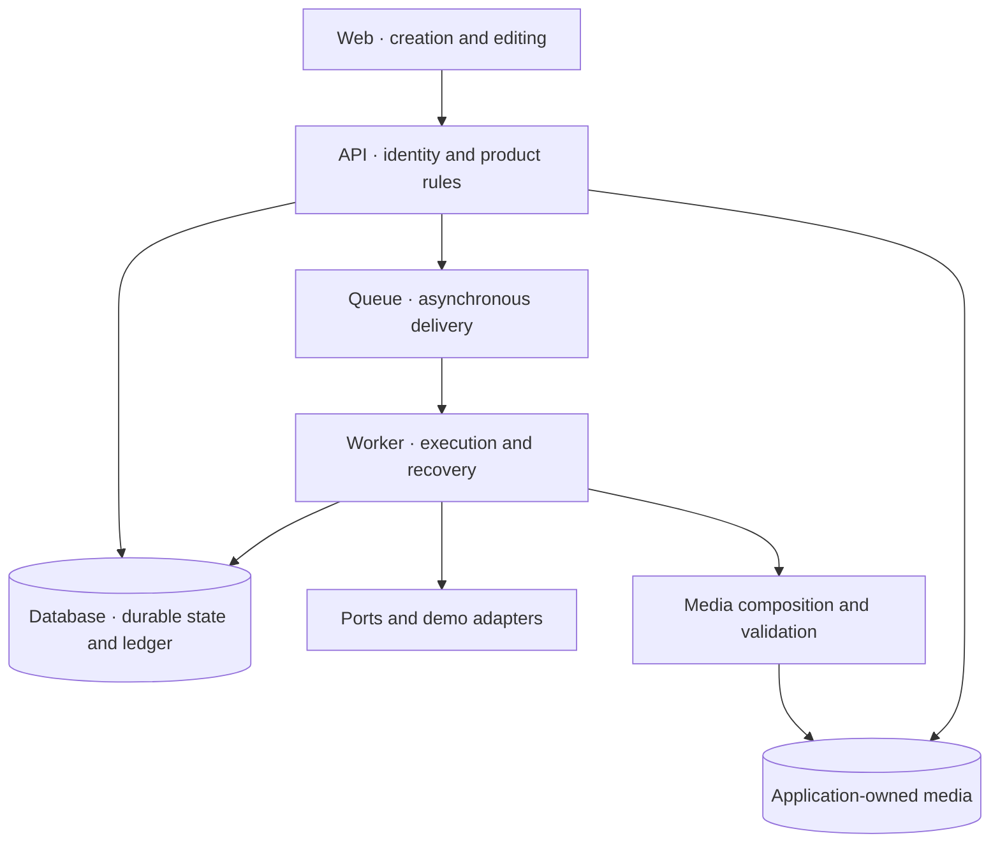

# AI Music — Technical Showcase

TypeScript monorepo for asynchronous music generation, personal-voice workflows, browser-based audio editing, and short-form video composition.

The application separates the web client, HTTP API, and background workers. PostgreSQL stores domain state and credit transactions; Redis/BullMQ schedules asynchronous work; FFmpeg handles media composition and validation.

This public snapshot uses demo adapters and illustrative configuration. Production credentials, commercial integration identities, proprietary prompts, routing policies, negotiated pricing, and infrastructure identifiers are excluded.

## Responsibilities and failure handling

| Concern | Implementation approach | Intended property |
| --- | --- | --- |
| Authorization | API-side identity and resource ownership checks | Client input cannot establish ownership |
| Long-running operations | Queue-backed background workers | Processing is independent of the HTTP request lifecycle |
| External task recovery | Persisted task identity and reconciliation | Known work can be recovered before resubmission |
| Composition retries | Separate source assets and render state | Local retries can reuse persisted assets |
| Credit accounting | Append-only ledger and idempotent transitions | Repeated event delivery does not duplicate eligible mutations |
| Media readiness | Output validation before publication | Readiness depends on a validated artifact |

## System architecture



## Architectural patterns

- **Ports and adapters:** domain-facing contracts separate product policy from integration mechanics.
- **Durable workflow state:** retries resume from recorded progress instead of process memory.
- **Idempotency and compensation:** ledger identities and recovery paths address repeated delivery and partial failure. No claim of global exactly-once execution.
- **Feature-oriented frontend:** UI features use a typed API boundary rather than importing persistence or worker internals.
- **Application-owned media:** generated assets become durable inputs to composition instead of relying on expiring external links.
- **Defense in depth:** ownership checks, server-side entitlements, local demo defaults and public-content checks address different trust boundaries.

Read the [architecture](docs/architecture.md), [engineering decisions](docs/engineering-highlights.md), [functional scope](docs/product-overview.md), and [security design](docs/security-design.md).

## Local setup

The source uses Next.js / React / TypeScript, Fastify, PostgreSQL / Prisma, Redis / BullMQ and FFmpeg. These are implementation technologies; commercial AI and payment integrations are represented by neutral demo boundaries.

```bash
corepack enable
pnpm install --frozen-lockfile
cp .env.example .env
pnpm db:generate
```

For local runtime exploration, provide local PostgreSQL and Redis, then run `pnpm db:push` and `pnpm dev`. Inspect `.env.example` for local ports. No paid account is required for the intended mock flows. Complete end-to-end runtime availability depends on the local database, queue and media tooling; this is not a production deployment distribution.

```bash
pnpm public:check
pnpm typecheck
pnpm lint
pnpm test
pnpm build
```

## Scope and limitations

This repository demonstrates application architecture, not a foundation model. The private product and this snapshot evolve separately. Security patterns described for the private system are not automatically guarantees of this demo: see the [implementation status](docs/security-design.md).

Commercial-looking fixture values are illustrative demo data. They do not disclose production prices, wholesale costs, margins or capacity. No customer counts, conversion rates, uptime figures or savings percentages are claimed here.

## Authorship

**Dmitriy Sedov** — application design and implementation across frontend, API, asynchronous processing, and media pipelines.

Copyright © 2026 Dmitriy Sedov. Published for portfolio review and technical evaluation. See [NOTICE](NOTICE) for usage restrictions.
