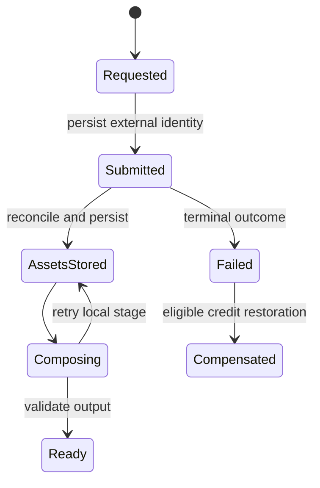

# Architecture: keep the creative flow simple, make failure explicit

The system separates interaction, authorization and execution. Web renders the experience; API owns access and domain rules; workers handle long-running work. PostgreSQL records domain truth. Queue delivery is a scheduling mechanism, not proof that an operation finished.

## Dependency direction

| Layer | Depends on | Must not depend on |
| --- | --- | --- |
| Web features | API client, browser-safe contracts | Database, worker, integration adapters |
| API | Contracts, persistence, queue and adapter ports | Web implementation |
| Worker | Contracts, persistence, media and adapter ports | Web implementation |
| Shared contracts | Schemas and pure helpers | Application entry points |
| Adapters | External transport and a domain contract | Frontend feature state |

Package-level ESLint restrictions enforce selected imports. They are not a proof of all transitive dependencies or dynamic runtime behavior.

## Model external work as a lifecycle

This is a conceptual model, not a literal enumeration shared by every entity. Keeping submission, persistence and composition distinct prevents a local rendering retry from automatically becoming another external purchase.

## Important consistency limits

A database write and a queue enqueue are separate systems. Do not describe them as atomic without a transactional outbox or equivalent implementation. Use durable intent, idempotent consumers and reconciliation for interrupted hand-offs. Likewise, callbacks may repeat or arrive out of order; domain transitions must establish whether an event is still applicable.

## Browser and server separation

Client-safe schemas belong in the shared contract surface. Node-only networking and filesystem code require explicit server entry points; never export them through a browser barrel. A signed media URL is an access capability, not permission to attach an application Bearer token to that origin.

## Public boundary

Neutral integration identifiers are demo labels, not hints about production vendor selection. Adapter payloads and retained state-machine examples are illustrative. Production routing, creative planning, prompt compilation and commercial policy stay private.
